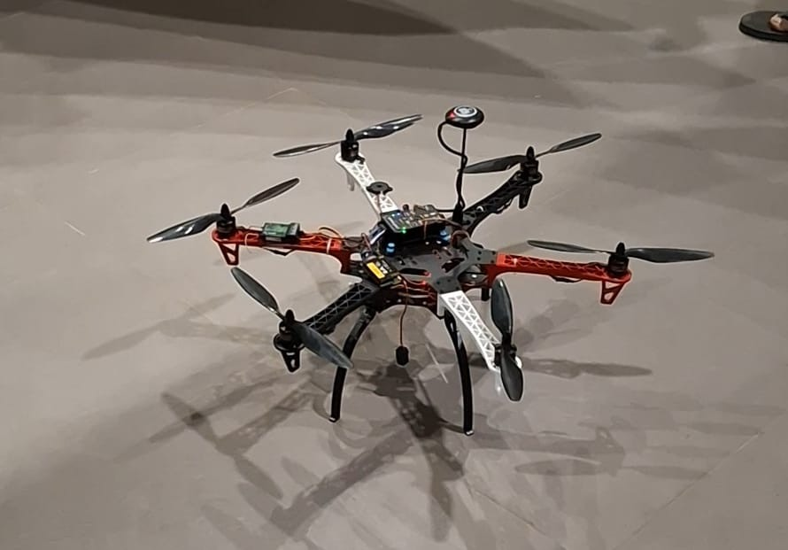
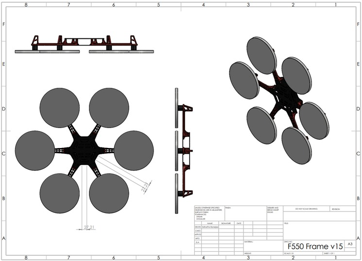
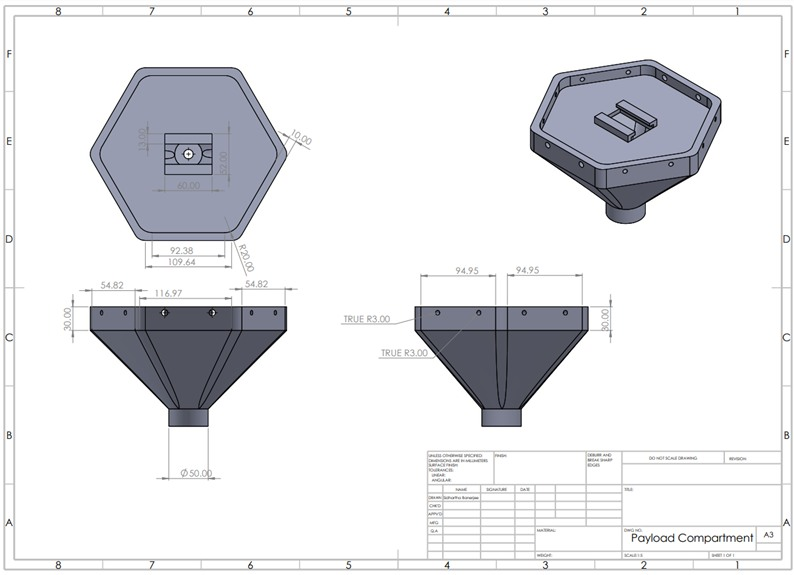
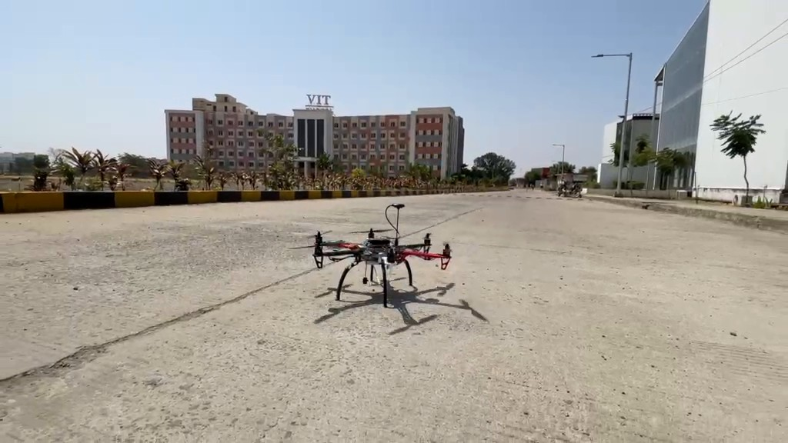
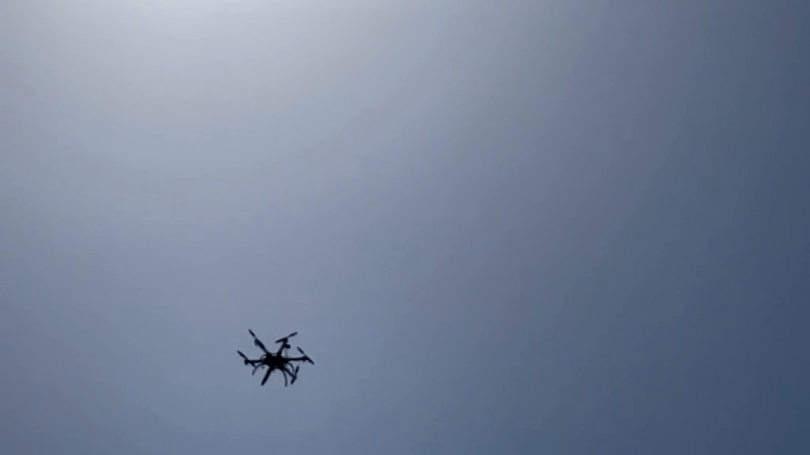
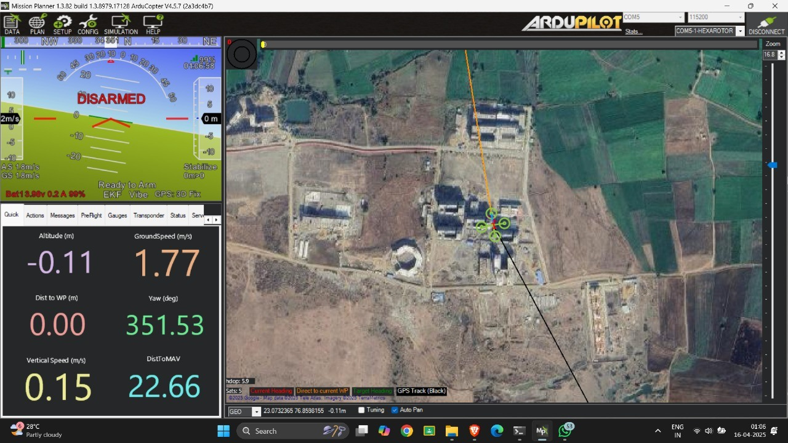

# A.I.R.S.
### Agricultural Integrated Robotics Swarm Systems

**An integrated aerial-robotics platform for precision agriculture**

Mechanical Design · Electronics · Flight Control · Computer Vision · Swarm Coordination

---

## Overview

A.I.R.S. is an engineering project exploring how aerial robotics, embedded systems, and AI-assisted crop monitoring can work together to support precision agriculture. The project is being developed around a **hexacopter platform**, with a longer-term system vision that includes coordinated drone coverage, crop-health analysis, and energy-aware operation.

This repository is intended to document the complete engineering system—not only its software. It spans the physical aircraft, mechanical design, power and control electronics, autonomous mission workflow, and the perception and coordination software being developed around it.

> **Development status:** This is an ongoing project. The prototype has undergone manual flight testing, and autonomous mission logic has been tested in simulation. Swarm coordination, onboard integration, and the wider end-to-end system remain active development goals. Planned capabilities are identified as such rather than presented as completed deployments.

## System overview

| Subsystem | Role |
|---|---|
| Mechanical platform | Hexacopter frame, landing gear, mounting, and payload-compartment design |
| Propulsion and power | Brushless motors, ESCs, Li-Po battery, power distribution, and voltage regulation |
| Flight control | Pixhawk-based stabilization, GPS navigation, flight modes, and failsafe configuration |
| Companion computing | Raspberry Pi 4B for higher-level mission logic, data handling, and vision workloads |
| Perception | Image-processing and machine-learning experiments for visual crop-stress indicators |
| Autonomy and coordination | Waypoint missions, simulation-based testing, and PSO research for multi-drone coverage |
| Sustainable operations | Solar-powered charging is part of the roadmap, not a completed capability |

## Mechanical design

The project uses a DJI F550 / Q550-class hexacopter frame. Mechanical work documented in the report includes the frame layout and a custom payload-compartment concept intended for agricultural payloads. Design considerations include secure mounting, payload storage, low mass, practical assembly, and integration with the airframe.

  

<em>Hexacopter frame design documented in the project report.</em>

  

<em>Payload-compartment design documented in the project report.</em>

## Electronics and embedded systems

The prototype hardware documented in the report includes:

- **Pixhawk 2.4.8** flight controller
- **Raspberry Pi 4B** companion computer
- **Brushless DC motors** with **EMAX Lightning 30 A ESCs**
- **2200 mAh Li-Po battery**
- **XT60 power distribution board**
- **MP1584 buck converter** for regulated power
- **GPS** and **433 MHz telemetry** for positioning and ground-station communication

Power distribution, voltage regulation, wiring integrity, component mounting, and safe integration are core parts of the build. The report records continuity checks and early system testing; detailed wiring diagrams and measured power budgets can be added as they are finalized.

## Prototype and flight testing

  

<em>Real project footage: prototype on the ground.</em>

The development path moves from a manually piloted aircraft toward repeatable autonomous missions.

- **Manual flight:** The report records successful arming/disarming, control response, stable hovering in low-wind conditions, and basic translational movement.
- **Ground-station missions:** GPS waypoint planning and mission configuration have been developed using Mission Planner, including AUTO, LOITER, and Return-to-Launch (RTL) modes and failsafe settings.
- **Simulation:** The autonomous route-planning workflow has been tested in a Software-in-the-Loop (SITL) environment.
- **Further validation:** The report notes that a motor failure interrupted real-world autonomous flight validation. Repair and renewed testing are prerequisites before claiming full autonomous field operation.

  

<em>Real project footage from the uploaded video.</em>

  

<em>Ground-station view included in the project report.</em>

## Crop-health perception

The intended perception pipeline uses images collected from an aerial platform to identify visual indicators that may be associated with crop stress. Work described in the project report includes:

1. Image preprocessing, including noise reduction and histogram equalization.
2. Crop-region segmentation using colour thresholds and contour analysis.
3. Extraction of visual indicators such as discoloration, patchiness, and irregular growth.
4. Machine-learning experiments using labelled crop imagery, including RGB and NDVI inputs.
5. Visualization of candidate affected regions using masks or annotated outputs.

The report records a **97.7% test-set accuracy** for a trained model. This is a result reported in the project document; it should be interpreted alongside the dataset, class balance, evaluation protocol, and model details when those are documented in the repository. It is not, by itself, evidence of equivalent performance in live onboard field conditions.

## Swarm coordination

A.I.R.S. has a longer-term multi-drone objective. Particle Swarm Optimization (PSO) is being explored for distributing coverage tasks, reducing overlapping flight paths, and adapting mission plans to field geometry or changing operating constraints.

The report describes this work as being in the simulation and development stage. Real-world multi-drone coordination and telemetry/mesh integration remain future validation milestones until demonstrated and documented.

## Development status

| Capability | Status documented in the project report |
|---|---|
| Hexacopter assembly and electronics integration | Prototype assembled |
| Initial manual flight | Tested |
| GPS waypoint mission workflow | Configured; route workflow tested in SITL |
| Autonomous flight in real-world conditions | Further validation pending after motor issue |
| Crop-image processing | Pipeline tested on datasets and drone footage |
| Crop classification model | Training/evaluation reported; deployment integration remains a goal |
| PSO-based multi-drone coordination | In development / simulation |
| Solar-powered autonomous charging | Roadmap concept |

This table reflects the supplied project report and should be updated as development continues.

## Repository contents

The repository structure is intentionally being kept as it currently stands while development continues.

- [`navigation/`](navigation/) — navigation and autonomous-flight work.
- [`notebooks/`](notebooks/) — exploratory and development notebooks.
- [`.gitignore`](.gitignore) — files excluded from version control.

This README does not assume that separate CAD, electronics, swarm-simulation, or documentation directories already exist.

## Project documentation

The EPICS final report covers system architecture, mechanical design, component selection, prototype assembly, initial flight tests, software progress, and the development roadmap. As the repository evolves, implementation details and test evidence should take precedence over high-level plans in the report.

## Current priorities

- Restore and validate the flight hardware after the reported motor issue.
- Repeat autonomous mission tests and record the results.
- Document wiring, power distribution, and component interfaces.
- Integrate perception workloads with the companion computer and measure onboard performance.
- Continue PSO simulation and define measurable multi-drone validation criteria.
- Develop and test the charging-station concept before describing it as operational.

## Team and project context

A.I.R.S. was developed as an **Engineering Project in Community Service (EPICS)** at **VIT Bhopal University**. It combines contributions across hardware assembly, mechanical design, sensing, image processing, machine learning, communication, and simulation.

---

**A.I.R.S. — bringing aerial robotics and intelligent sensing into the precision-agriculture workflow.**

Research prototype · In active development

